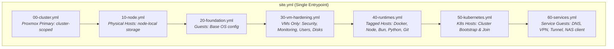
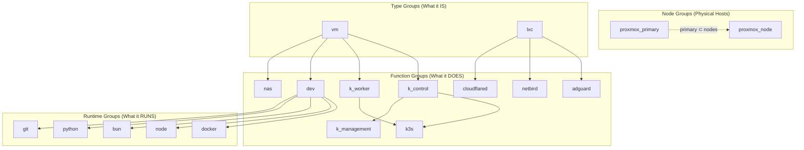

# Server Configuration Management with Ansible

This part of the repository contains the Configuration Management layer for all managed hosts (physical nodes, VMs, and LXC containers) using Ansible. It sits between the Infrastructure Provisioning layer (OpenTofu) and the Container Orchestration layer (Kubernetes), transforming raw hosts into production-ready nodes.

The project uses a layered playbook architecture with role-based composition, ensuring that each host receives only the configuration it needs based on its inventory group membership.

## 1. Summary & System Purpose

### Core Principles

This system is a direct implementation of our core principles, realized through the following key concepts:

*   **Configuration as Code & GitOps:** All server configurations, roles, and playbooks are version-controlled. Changes are introduced through Git and applied via Taskfile commands.
*   **Layered Playbook Architecture:** The configuration is divided into 7 ordered layers (`00` through `60`) running **cluster → node → guest**, each targeting a specific concern. Layers execute in sequence via a single `site.yml` entrypoint, so lower layers (physical infrastructure) are ready before guests consume them.
*   **Role-Based Composition:** The logic for configuring a capability (e.g., installing Docker, hardening SSH) is encapsulated in self-contained roles within the `roles/` directory. Playbooks focus on *which hosts get which roles*, while roles define *how* to configure them.
*   **Inventory-Driven Targeting:** Host group membership in the inventory determines which roles are applied. A host in the `k3s` group gets K3s roles; a host in the `adguard` group gets DNS roles. No manual selection required.
*   **Auto-Generated Inventory:** The inventory files in `inventory.d/` are **generated by OpenTofu**, not manually maintained. Each Tofu stack produces its own inventory fragment, and Ansible merges them automatically via the `inventory.d/` directory convention.
*   **Idempotent Execution:** All roles are designed to be safely re-run. Running `site.yml` against an already-configured host produces no changes.
*   **Secure Secret Management (Ansible Vault):** Sensitive variables (API keys, tunnel tokens, setup keys) in the inventory are encrypted with Ansible Vault before being committed to Git.

### Scope

*   **In Scope:** OS-level configuration, package installation, user management, SSH hardening, firewall rules, Kubernetes cluster bootstrapping (K3s and Kubeadm), platform service installation (AdGuard, NetBird, Cloudflare Tunnel, NFS), and ArgoCD deployment.
*   **Out of Scope:** VM/LXC provisioning (handled by OpenTofu), Kubernetes application deployment (handled by ArgoCD/Kustomize), and application-level configuration.

### Prerequisites

Before operating this system, ensure the following are in place:

1.  **A Control Machine:** A dedicated Linux VM with network connectivity to all managed hosts.
2.  **Ansible:** Installed on the Control Machine (includes `ansible-vault` for secret management).
3.  **SSH Access:** SSH keys loaded or agent forwarding active for passwordless access to all targets.
4.  **Task:** [go-task/task](https://taskfile.dev/) installed for standardized command execution.
5.  **Generated Inventory:** OpenTofu must have run at least once to generate the inventory files in `inventory.d/`.

---

## 2. System Architecture

### The 7-Layer Execution Model (cluster → node → guest)

All configuration flows through `site.yml`, which imports 7 playbooks in strict order. Each layer builds on the previous one, from the physical cluster up to guest workloads.



| Layer | Playbook | Targets | Purpose |
|:---:|---|---|---|
| **00** | `00-cluster.yml` | `proxmox_primary` | Cluster-scoped config, applied once by the Proxmox primary (scaffold: SDN VLANs, shared storage definitions, firewall, replication) |
| **10** | `10-node.yml` | `proxmox_node` | Node-local config per physical host — storage: ZFS pools, datasets, share roots, NFS exports, Samba. Runs before guests so storage exists first |
| **20** | `20-foundation.yml` | `vm`, `lxc`, `dev` | Universal guest baseline: timezone, locale, hostname, core packages, dev utilities |
| **30** | `30-vm-hardening.yml` | `vm` only | SSH hardening, UFW firewall, Fail2Ban, monitoring agents, user accounts, disk mounts |
| **40** | `40-runtimes.yml` | `docker`, `node`, `bun`, `python`, `git` | Language runtimes and development tooling |
| **50** | `50-kubernetes.yml` | `kind`, `kubeadm`, `k3s`, `k_control`, `k_worker`, `k_management` | Cluster provisioning (Kind, Kubeadm, K3s), ArgoCD management layer |
| **60** | `60-services.yml` | `adguard`, `netbird`, `cloudflared`, `nas` | Guest platform services: DNS, VPN mesh, tunnel daemon, NFS client |

### Layer Execution Detail

**Layer 50 (Kubernetes)** is the most complex, with 6 plays that handle different cluster types and node roles:

```
50-kubernetes.yml
├── Dev/Test (Kind)           → hosts: kind
├── Prod Control (Kubeadm)    → hosts: k_control:&kubeadm  (serial: 1)
├── Prod Workers (Kubeadm)    → hosts: k_worker:&kubeadm
├── Prod Control (K3s)        → hosts: k_control:&k3s      (serial: 1)
├── Prod Workers (K3s)        → hosts: k_worker:&k3s
└── Management (ArgoCD)       → hosts: k_management:&k_control
```

> [!NOTE]
> Control plane bootstrap uses `serial: 1` to ensure the first node initializes completely before additional nodes attempt to join. Worker joins run in parallel.

---

## 3. Inventory System

### Source: Auto-Generated by OpenTofu

The `inventory.d/` directory uses Ansible's [directory-based inventory](https://docs.ansible.com/ansible/latest/inventory_guide/intro_inventory.html#using-multiple-inventory-sources) feature. Each OpenTofu stack generates its own YAML file:

| Inventory File | Generated By | Content |
|---|---|---|
| `proxmox_atlas.yml` | `tofu/stacks/onprem/proxmox_atlas` | All on-prem hosts, groups, and host-specific variables |
| `aws_kyoto.yml` | `tofu/stacks/cloud/aws_kyoto` | AWS-related variables (e.g., Velero S3 credentials) |
| `cloudflare_alexandria.yml` | `tofu/stacks/cloud/cloudflare_alexandria` | Cloudflare tunnel tokens, zone IDs |
| `netbird_samarkand.yml` | `tofu/stacks/cloud/netbird_samarkand` | NetBird setup keys |

> [!CAUTION]
> **Never edit inventory files manually.** They are regenerated on every `tofu apply`. Changes will be overwritten. To modify host groups or variables, update the OpenTofu stack configuration in `tofu/stacks/`.

### Host Group Architecture

Hosts are assigned to multiple groups simultaneously. Group membership determines which roles are applied.



> **Node groups:** physical hosts are identified by `proxmox_node` (every hypervisor) and `proxmox_primary` (the cluster primary, for cluster-wide work). There are **no per-node-name groups**.

---

## 4. Role Catalog

All roles live in `ansible/roles/`. Each role is a self-contained Ansible role with `tasks/`, `defaults/`, `handlers/`, and/or `templates/` directories.

### Node & Storage Roles

| Role | Layer | Purpose | Applied To |
|---|:---:|---|---|
| `nas_server` | 10 | Host-level NAS: ZFS pools/datasets, data disks, `/etc/exports`, Samba, SMART — driven by each node's inventory `storage` var | `proxmox_node` |

> The cluster layer (`00`) has no roles yet (scaffold); cluster-scoped config — SDN VLANs, shared storage definitions, firewall, replication — will live there, applied by `proxmox_primary` only.

### Foundation & Hardening Roles

| Role | Layer | Purpose | Applied To |
|---|:---:|---|---|
| `base` | 20 | System basics: timezone, locales, hostname, core packages | `vm`, `lxc` |
| `dev` | 20 | Developer utilities: vim, htop, dnsutils, etc. | `dev` |
| `security` | 30 | SSH hardening, UFW firewall, Fail2Ban | `vm` |
| `monitoring` | 30 | Node Exporter, QEMU Guest Agent | `vm` |
| `users` | 30 | User accounts, Git config, SSH authorized keys | `vm` |
| `storage_setup` | 30 | Mount additional disks (e.g., `/dev/sdb` → `/data/storage`) | `vm` |

### Runtime Roles

| Role | Layer | Purpose | Applied To |
|---|:---:|---|---|
| `docker` | 40 | Docker Engine (standalone) | `docker` |
| `node` | 40 | Node.js runtime (version-controlled via `node_version` var) | `node` |
| `bun` | 40 | Bun runtime | `bun` |
| `python` | 40 | Python 3 runtime | `python` |
| `git` | 40 | Git installation and user configuration | `git` |
| `podman` | 40 | Podman container runtime (alternative to Docker) | *(future)* |

### Kubernetes Roles

| Role | Layer | Purpose | Applied To |
|---|:---:|---|---|
| `k8s_repo` | 50 | Manage official Kubernetes APT repositories | `kind`, `kubeadm` |
| `kind` | 50 | Kind cluster provisioning (dev/test) | `kind` |
| `kubeadm` | 50 | Kubeadm binaries, kernel modules, prerequisites | `kubeadm` |
| `kubeadm_cluster` | 50 | Kubeadm cluster init, CNI, control-plane join, worker join | `kubeadm` |
| `k3s` | 50 | K3s binary, dependencies, install script | `k3s` |
| `k3s_cluster` | 50 | K3s cluster init, control-plane join, worker join | `k3s` |
| `kubectl` | 50 | kubectl CLI installation | *(standalone)* |
| `helm` | 50 | Helm package manager | `kind`, `k_control` |
| `storage_local` | 50 | Local storage class setup for Kubernetes | `k_control` |
| `argocd` | 50 | ArgoCD Helm deployment, fleet management configuration | `k_management` |

> [!NOTE]
> **Historical context:** The manual kubeadm steps that previously lived in this document (cluster init, CNI installation, ArgoCD bootstrap) are now fully automated by the `kubeadm`, `kubeadm_cluster`, and `argocd` roles. See `ansible/roles/kubeadm_cluster/` and `ansible/roles/argocd/` for the current implementation.

### Platform Service Roles

| Role | Layer | Purpose | Applied To |
|---|:---:|---|---|
| `adguard` | 60 | AdGuard Home DNS server | `adguard` |
| `netbird` | 60 | NetBird mesh VPN client | `netbird` |
| `cloudflared` | 60 | Cloudflare Tunnel daemon | `cloudflared` |
| `nas_client` | 60 | Mount NAS shares (NFS); resolves each host's `nas_mounts` (provider+share) from the inventory | `nas` |

---

## 5. Operational Guide (How-To Recipes)

All Ansible operations are executed through Taskfile commands from the repository root. The Taskfile lives at `ansible/Taskfile.yml`.

### Verify Connectivity

```bash
# Ping all managed hosts
task ansible:ping
```

### Apply All Configuration

```bash
# Full site run — applies all 7 layers in order (cluster → node → guest)
task ansible:apply:all
```

### Apply to a Specific Host Group

```bash
# Apply only to a specific group (e.g., K3s management nodes)
task ansible:apply:hostgroup group=k_management
```

### Apply Only Specific Roles (by Tag)

```bash
# Apply only the ArgoCD role across applicable hosts
task ansible:apply:tag tag=argocd
```

### Dry Run (Check Mode)

```bash
# Preview changes without applying
task ansible:check
```

### Run Ad-Hoc Shell Commands

```bash
# Run a command on a group of hosts
task ansible:shell group=k_control cmd="kubectl get nodes"

# With sudo
task ansible:shell group=k_control cmd="systemctl status k3s" become=true
```

### View Inventory Graph

```bash
# Display the full inventory tree
task ansible:inventory
```

### Wait for Cloud-Init

```bash
# Wait until cloud-init completes on freshly provisioned VMs
task ansible:wait-ready
```

---

## 6. Execution Flow Diagram

This diagram shows the complete journey from OpenTofu provisioning to a fully configured node:

```mermaid
flowchart TD
    subgraph OpenTofu["Layer 1: OpenTofu (Provisioning)"]
        TF[tofu apply] --> VM[VM/LXC Created]
        TF --> INV[Inventory Generated<br/><code>inventory.d/*.yml</code>]
    end

    subgraph Ansible["Layer 2: Ansible (Configuration)"]
        INV --> SITE[site.yml]
        SITE --> F[00: Foundation<br/>Base + Dev]
        F --> H[10: VM Hardening<br/>Security + Monitoring + Users + Disks]
        H --> R[20: Runtimes<br/>Docker + Node + Bun + Python + Git]
        R --> K[30: Kubernetes<br/>K3s/Kubeadm Init + ArgoCD]
        K --> S[40: Services<br/>AdGuard + NetBird + Cloudflare + NAS]
    end

    subgraph Kubernetes["Layer 3: Kubernetes (Orchestration)"]
        K --> ARGO[ArgoCD Watches Git]
        ARGO --> APPS[Applications Deployed]
    end

    style OpenTofu fill:#0b2354,stroke:#0277bd
    style Ansible fill:#1a4731,stroke:#2e7d32
    style Kubernetes fill:#4a1942,stroke:#7b1fa2
```



---

## 7. Configuration Reference

### `ansible.cfg` Key Settings

| Setting | Value | Purpose |
|---|---|---|
| `inventory` | `./inventory.d` | Auto-merge all inventory files in directory |
| `roles_path` | `./roles` | Role search path |
| `host_key_checking` | `false` | Skip SSH fingerprint prompts for ephemeral VMs |
| `forks` | `20` | Parallel execution across up to 20 hosts |
| `pipelining` | `True` | ~70% reduction in SSH operations per task |
| `gathering` | `smart` | Cache facts; skip re-gathering on re-runs |
| `fact_caching` | `jsonfile` | Cache facts to `/tmp/ansible_fact_cache` (24h TTL) |

### Secret Management

Sensitive inventory data is encrypted using Ansible Vault before committing to Git. Each Tofu stack may generate a `.secret.yml` inventory fragment that must be encrypted:

```bash
# Encrypt a file
ansible-vault encrypt inventory.d/sensitive_file.yml

# Decrypt for inspection (temporary)
ansible-vault view inventory.d/sensitive_file.yml

# Run playbooks with vault password
task ansible:apply:all -- --ask-vault-pass
```

---

## 8. Maintenance & Lifecycle

### Adding a New Role

1.  Create the role directory structure under `ansible/roles/<role_name>/`.
2.  Add the role to the appropriate layer playbook (`playbooks/XX-*.yml`).
3.  Ensure the OpenTofu stack assigns the target host to the correct inventory group.
4.  Test with `task ansible:check` before applying.

### Adding a New Host

1.  Define the VM/LXC in the OpenTofu stack configuration.
2.  Run `tofu apply` — this generates the updated inventory automatically.
3.  Run `task ansible:apply:all` — the new host receives all applicable roles.

### Resetting a Kubernetes Cluster

A dedicated playbook exists for destructive cluster teardown:

```bash
# WARNING: Destroys the Kubeadm cluster completely
ansible-playbook -i inventory.d reset_kubeadm.yml
```

This resets kubeadm, stops kubelet, removes all cluster data directories, flushes iptables, and removes CNI network interfaces. Use only when a full cluster rebuild is required.

### Cross-Reference

| Related Document | Purpose |
|---|---|
| [OpenTofu Layer](./tofu.md) | How VMs/LXCs are provisioned (Layer 1) |
| [Kubernetes Layer](./kubernetes.md) | How applications are deployed (Layer 3) |
| [VM Lifecycle Guide](../guides/ansible-vm-lifecycle.md) | Visual journey of a VM from birth to cluster integration |
| [Secrets Management Policy](../secrets/01-secrets-management-policy.md) | Full secret management rules |
| [Getting Started](../GETTING_STARTED.md) | Developer onboarding and tool installation |